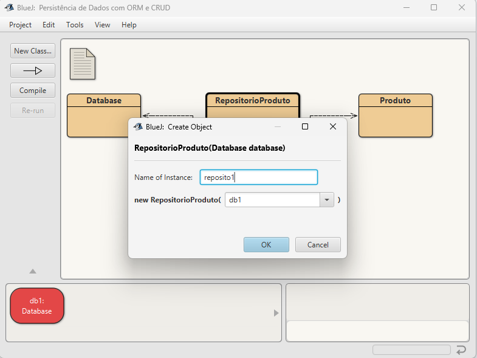

# Atividade Prática – Persistência de Dados com ORM e CRUD
Repositório GitHub: [Insira a URL do seu repositório aqui]

## Descrição da Implementação
Para esta atividade, foi desenvolvida uma simulação de um sistema de estoque de produtos. A classe de modelo escolhida foi a entidade Produto, mapeada para o banco de dados relacional SQLite utilizando o ORMLite.

A classe Produto contém os seguintes atributos mapeados:

id (Chave primária gerada automaticamente)

nomeProduto (Nome do item, ex: "Cereal", "Refrigerante", "Detergente")

quantidade (Quantidade em estoque)

tipoProduto (Categoria do item, ex: "Alimento", "Líquido", "Limpeza")

A persistência foi estruturada seguindo o padrão Repository (através da classe RepositorioProduto), que encapsula o DAO fornecido pelo ORMLite. O gerenciamento do banco de dados é feito pela classe Database, criando o arquivo local ProdutosDb.db.

##Inicialização e Conexão com o Banco de Dados
Ao instanciar a classe Database, o banco de dados ProdutosDb.db é configurado e a conexão via JDBC é estabelecida com sucesso.

Instância da classe Database apontando para o arquivo "ProdutosDb.db".

Figura 2: Mensagem no terminal confirmando a abertura do banco de dados.

##1. CREATE (Cadastrar um novo objeto)
O método create foi implementado no repositório para salvar instâncias da classe Produto no banco de dados, utilizando o método dao.create().

Figura 3: Implementação do método create na classe RepositorioProduto.

Foram instanciados três produtos (Cereal, Refrigerante e Detergente) no ambiente BlueJ e passados ao repositório para persistência.

Figura 4: Objetos criados em memória no BlueJ prontos para serem salvos.

Abaixo, a comprovação visual utilizando o DB Browser for SQLite demonstrando que os três objetos foram convertidos em registros na tabela produto do banco de dados.

Figura 5: Evidência da persistência dos dados, onde os objetos foram efetivamente armazenados no arquivo SQLite.

##2. READ (Consultar objetos cadastrados)
Foram implementados métodos de leitura para buscar um produto específico pelo seu ID (loadFromId) e para resgatar todos os produtos cadastrados (loadAll).

Figura 6: Implementação dos métodos de leitura e listagem.

A execução do método loadAll() retorna um ArrayList<Produto> preenchido com as informações extraídas do banco de dados, reconstruindo os objetos originais.

Figura 7: Inspeção do ArrayList retornado, mostrando os 3 produtos carregados com sucesso do banco de dados.

##3. UPDATE (Atualizar dados de um objeto existente)
A operação de atualização é acionada ao modificar o estado de um objeto Produto já persistido e utilizar o DAO para atualizar a linha correspondente no banco. No exemplo abaixo, a quantidade do produto "cereal" está sendo alterada para 10.

Figura 8: Chamada do método modificador (setter) definindo uma nova quantidade para o produto Cereal.

##4. DELETE (Excluir um objeto)
O método delete remove o registro correspondente ao objeto passado como parâmetro do banco de dados e também o retira da lista de controle em memória.

Figura 9: Implementação do método delete tratando a remoção através do DAO.

Abaixo, a execução prática onde o produto "detergente" é enviado ao método delete do repositório para ser removido permanentemente do estoque.

Figura 10: Chamada do método delete passando o objeto "detergente" para exclusão.
