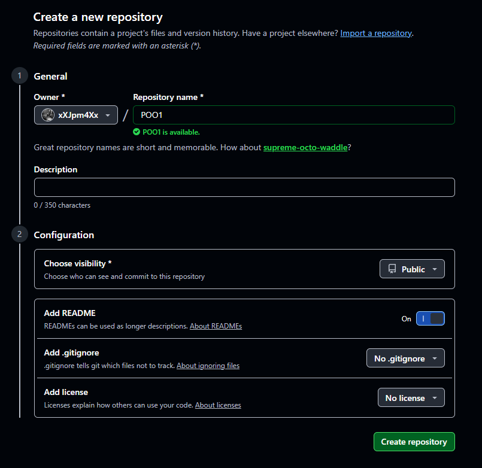
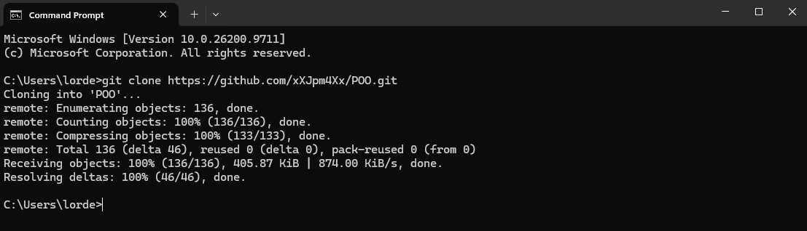
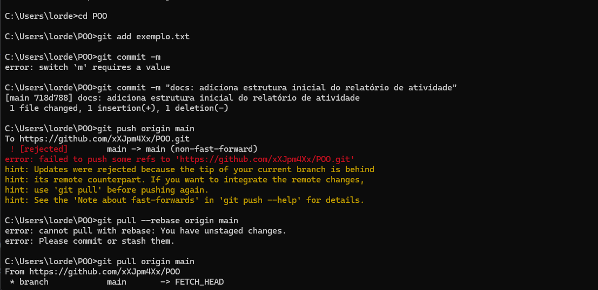
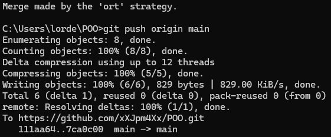
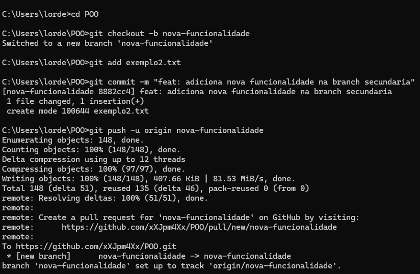
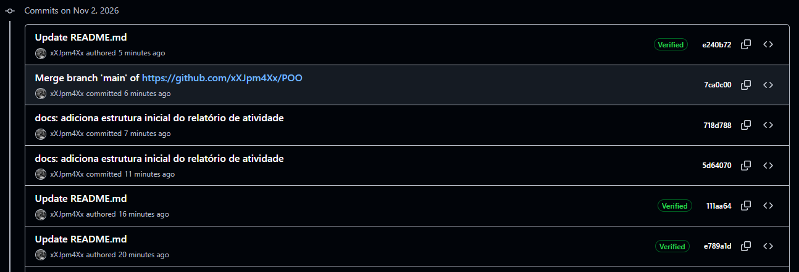
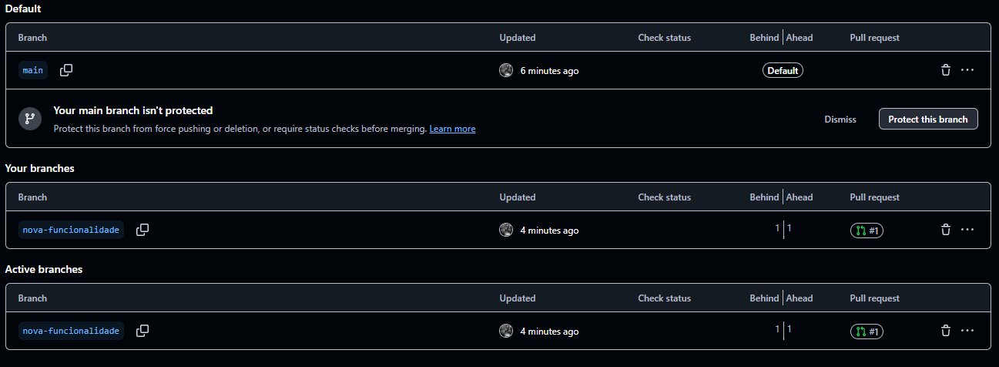

# Atividade Prática – Controle de Versões com Git e GitHub
Este documento apresenta o passo a passo e as evidências da atividade prática sobre o uso dos principais recursos de controle de versão utilizando Git e GitHub.

---

## 1. Criação do Repositório

A primeira etapa consistiu em criar um repositório público na minha conta pessoal do GitHub. O repositório foi nomeado como `POO`.


---

## 2. Clonagem do Repositório

Com o repositório criado remotamente, o próximo passo foi trazê-lo para o ambiente local. Para isso, abri o terminal e utilizei o comando de clonagem com a URL fornecida pelo GitHub.

**Comando utilizado:**
```bash
git clone https://github.com/xXJpm4Xx/POO.git
```

Após a execução, acessei a pasta do projeto clonado:
```bash
cd POO
```


---

## 3. Edição e Versionamento

Nesta etapa, criei um arquivo inicial no repositório `Exemplo.txt`, registrei as alterações e as enviei para o GitHub.

**Comandos utilizados:**
```bash
# 1. Adicionando o arquivo modificado/criado à área de stage
git add exemplo.txt

# 2. Registrando as alterações no histórico (commit)
git commit -m "docs: adiciona estrutura inicial do relatório de atividade"

# 3. Enviando os commits do repositório local para o GitHub
git push origin main
```






---

## 4. Criação e Alteração de Ramo (Branch)

Para simular um fluxo de trabalho real, criei uma nova ramificação (branch) para trabalhar em uma funcionalidade isolada, realizei uma alteração e enviei essa nova branch para o repositório remoto.

**Comandos utilizados:**
```bash
# 1. Criando e alternando para um novo ramo chamado 'nova-funcionalidade'
git checkout -b nova-funcionalidade

# (Neste momento, um arquivo foi alterado ou um novo arquivo foi criado)

# 2. Adicionando e "comitando" a alteração na nova branch
git add exemplo2.txt
git commit -m "feat: adiciona nova funcionalidade na branch secundaria"

# 3. Enviando a nova branch e seus commits para o GitHub
git push -u origin nova-funcionalidade
```



---

## 5. Evidências Finais no GitHub

As imagens abaixo comprovam que todas as operações locais foram refletidas com sucesso no repositório remoto no GitHub.

### Histórico de Commits
Abaixo está a visualização do histórico de commits, demonstrando as diferentes alterações registradas ao longo da atividade.



### Existência dos Diferentes Ramos (Branches)
Abaixo está a comprovação de que ambas as branches (`main` e `nova-funcionalidade`) existem e estão sincronizadas no GitHub.


